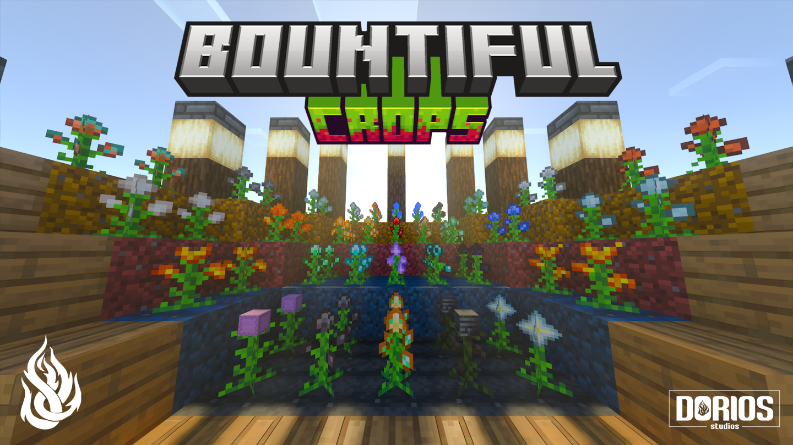

Turn resources you already have into crops you can harvest repeatedly. Start with a Base Seed, craft the seed for your chosen resource and plant it on the soil that matches its tier.

## Crop and Soil Tiers

| Tier | Soil | Seeds |
| --- | --- | --- |
| 1 | Yellow Soil | Coal, Copper, Dyes, Glass, Gunpowder, Iron, Leather, Prismarine Crystals, Prismarine Shards, Water, Wool |
| 2 | Red Soil | Ghast Tear, Glowstone, Gold, Honey, Lapis, Lava, Quartz, Redstone, Resin, Slime |
| 3 | Blue Soil | Amethyst, Blaze, Diamond, Emerald, Ender Pearl, Obsidian |
| 4 | Black Soil | Netherite, Nether Star, Shulker, Totem, Wither |

## Crafting the Base Seed

At a crafting table, put **1 wheat seed** in the center, **4 bone meal** on the sides and **4 glass** in the corners. Use the Base Seed with the ingredients for the crop you want. To make **Iron Seeds**, for example, put a Base Seed in the center and surround it with **8 iron ingots**.

## Resource Drops

Interact with a mature plant to collect its resources and reset it to the first growth stage. Breaking a mature plant also returns the seed you need to replant it.

| Crop | Drops per mature harvest before Fortune |
| --- | --- |
| Copper | 4–8 Raw Copper |
| Iron | 2–4 Raw Iron |
| Lapis | 6–12 Lapis Lazuli |
| Quartz | 6–12 Nether Quartz |
| Resin | 3–6 Resin Clumps |
| Diamond | 2–3 Diamond Shards |
| Emerald | 2–3 Emerald Shards |
| Netherite | 2–4 Netherite Nuggets |
| Nether Star | 2–4 Nether Star Fragments |
| Shulker | 2–4 Shulker Shell Shards |

When you interact with the crop using a Fortune tool, the harvest amount is multiplied by **1.2×, 1.4× or 1.6×** for Fortune I, II or III, with fractional amounts rounded by chance. You can craft shards, fragments and nuggets into their full resources.

## Special Crops

Water, Lava and Honey produce balls of their respective liquids. Combine Water and Lava Balls to craft Obsidian, or use Honey Balls in the recipes for Honey Bottles and Honey Blocks.

## Accelerating Growth

Put an **Accelerator Clock** on a **Pedestal** at the same height as your crops. It attempts to advance crops in a **9×9** area centered on the Pedestal. The Diamond and Nether Star clocks have a higher chance of advancing each crop than the standard clock. Interact with the Pedestal again to take the clock back.

## Integration with UtilityCraft

The addon registers its crop seeds with UtilityCraft’s plant system, so a compatible Bonsai Pot can grow them in a compact setup.
