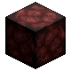
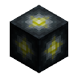
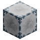

Compressy combines stacks of common materials into blocks or bundles that you can unpack later. These recipes come from version **1.0.3**.

  
  
  

## Compress and unpack {#recipes}

Fill a crafting table’s 3×3 grid with one block or item per slot to make one compressed result. Put a single compressed result back in the crafting grid to recover the nine inputs. **Paper** is the exception: use six sheets in two complete rows to make one Ream of Paper, which unpacks into six sheets.

## Block compression tiers {#tiers}

Each level uses nine blocks of the preceding level. Most materials stop at tier 4. Cobblestone continues through tier 9. Nether Stars have a separate first step: nine stars make one Nether Star Block, and that block then has four compression tiers. Its tier 4 represents **59,049 stars**.

| Tier | Units of the original block |
| ---: | ---: |
| 1 | 9 |
| 2 | 81 |
| 3 | 729 |
| 4 | 6,561 |
| 5 | 59,049 |
| 6 | 531,441 |
| 7 | 4,782,969 |
| 8 | 43,046,721 |
| 9 | 387,420,489 |

## Supported materials {#materials}

| Family | Crafting input |
| --- | --- |
| Stone | Andesite, basalt, blackstone, calcite, cobbled deepslate, cobblestone, crying obsidian, deepslate, diorite, dripstone block, end stone, granite, netherrack, obsidian, stone and tuff |
| Soil and building materials | Clay, dirt, glass, gravel, honey block, moss block, mud, red sand, sand, slime block, soul sand and soul soil |
| Mineral and other storage blocks | Amethyst, coal, copper, diamond, emerald, gold, iron, lapis lazuli, netherite, quartz, raw copper, raw gold, raw iron, redstone and Nether Star |
| Wood | Acacia, birch, cherry, dark oak, jungle, mangrove, oak, pale oak and spruce wood, plus bamboo block, crimson hyphae and warped hyphae |
| Dyes and crops | All 16 dyes, beetroot seeds, cocoa beans, melon seeds, pitcher pod, pumpkin seeds, torchflower seeds and wheat seeds |
| Miscellaneous items | Blaze powder and rods, breeze rods, cookies, feathers, ghast tears, glow ink sacs, glowstone dust, gunpowder, ink sacs, paper, spider eyes, fermented spider eyes, sticks, string and sugar |

Compressy shares item and block identifiers with UtilityCraft. Use Compressy as a standalone alternative in worlds where you want only the compression recipes.

[Compression and unpacking recipes](https://github.com/DoriosStudios/Compressy/tree/970fce3bebe70d96d6cecade2e738c982bf6e90f/BP/recipes/compressed)
