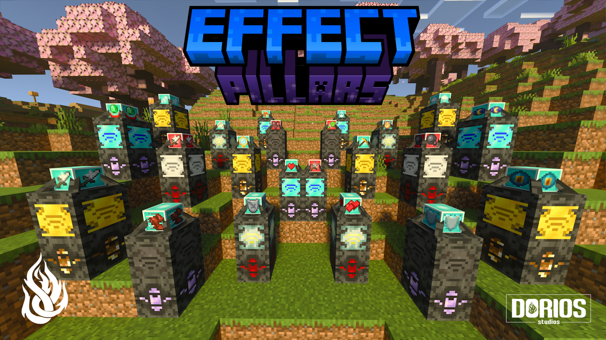

Build an Effect Pillar to apply a status effect around a base, mine or mob farm. You choose the effect, its level and its range independently.

## Pillar Components

Build the stack from the bottom up. Place the **Base Stone** as the foundation, then the **Level** block, then the **Range** block, and finally the **Effect** block. The effect block checks the two blocks immediately beneath it. Interact with the effect block to turn it on or off.

### Upgrades (Effect Level)

| Level block | Status effect level | Area Damage per pulse |
| --- | ---: | ---: |
| Redstone | I | 1 |
| Glowstone | II | 2 |
| Amethyst | III | 3 |

### Amplifiers (Effect Range)

| Range block | Radius from the effect block |
| --- | ---: |
| Iron | 25 blocks |
| Gold | 50 blocks |
| Diamond | 75 blocks |
| Netherite | 100 blocks |
| Nether Star | 250 blocks |

### Effect Beacons

| Target | Effects |
| --- | --- |
| Players within range | Absorption, Conduit Power, Fire Resistance, Haste, Health Boost, Hero of the Village, Invisibility, Jump Boost, Night Vision, Regeneration, Resistance, Saturation, Slow Falling, Speed, Strength and Water Breathing |
| Sneaking players within range | Levitation |
| Monsters within range | Area Damage, Poison, Slowness, Weakness and Wither |

Use **Haste** above a mine or **Water Breathing** over an underwater build. For Levitation, hold sneak while within range to rise.

## Base Stone

Put one block of coal in the center of a crafting grid, four blackstone on the sides, and four cobbled deepslate in the corners.

## Guide Book

Combine **1 paper** with **1 Base Stone** at a crafting table to make the Effect Pillars guide book. Open it in-game to look up the individual effect recipes.
