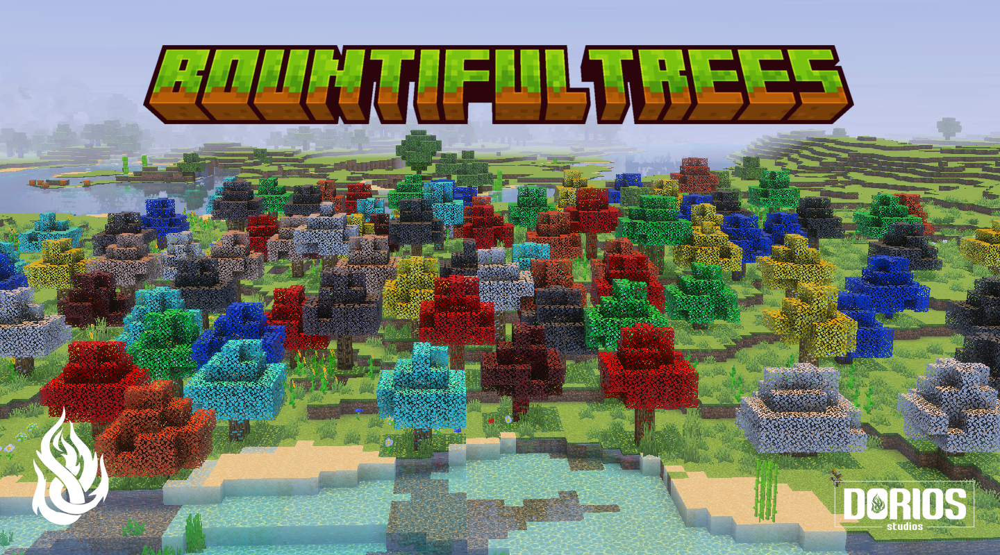

Craft an ore sapling from materials you already have, then grow it to harvest more of that resource. Breaking the leaves can return saplings for replanting.

## Crafting Ore Saplings

Place an **oak sapling** in the center of the crafting table. Use the layout in your sapling’s recipe group.

| Saplings | Pattern around the oak sapling |
| --- | --- |
| Copper, Iron, Gold, Diamond, Emerald, Netherite | Put one storage block directly below the sapling. Fill the other seven spaces with the loose material. |
| Coal, Redstone, Lapis, Quartz | Put storage blocks on the four sides. Fill the four corners with the loose material. |

For example, a **Redstone Sapling** takes four blocks of redstone and four redstone dust. A **Copper Sapling** takes one block of copper and seven copper ingots.

## Growth and Harvest

Plant the sapling with room for its canopy to spread up to two blocks each way. It can grow naturally on a random tick. Each application of bone meal gives it a **20% chance** to grow immediately.

Harvest the ore logs with an **axe or pickaxe**. Each eligible log gives its corresponding resource, and Fortune can add more. The oak sapling is the starting ingredient for the recipe. The ore logs are the source of the materials below.

| Tree | Resource from the trunk |
| --- | --- |
| Coal | Coal |
| Copper | Raw Copper |
| Iron | Raw Iron |
| Gold | Raw Gold |
| Redstone | Redstone Dust |
| Lapis | Lapis Lazuli |
| Quartz | Nether Quartz |
| Diamond | Diamond |
| Emerald | Emerald |
| Netherite | Netherite Scrap |

Break the leaves to try for sticks or a matching ore sapling.

## UtilityCraft Compatibility

Bountiful Trees registers saplings with UtilityCraft’s plant system for compatible Bonsai Pots. The Bonsai harvest tables can use different forms of a resource, such as Diamond Shards and Netherite Nuggets.

## Downloads

[CurseForge](https://www.curseforge.com/minecraft-bedrock/addons/bountiful-trees/files/all) · [MCPEDL](https://mcpedl.com/bountiful-trees/#downloads)
