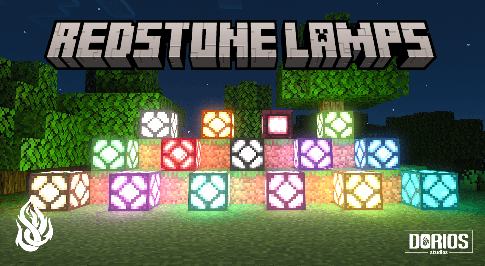

Redstone Lamps Plus brings the lamp designs of LicitLettuce’s Java Edition project to Minecraft Bedrock. Use them for switchable lighting in builds with redstone wiring.

## How It Works

1. Place a lamp and connect a redstone source. A lever next to the lamp is a simple way to test it.
2. Power the lamp to light it.
3. Break or switch off the signal to put the lamp out.

For a timed pulse, use a button. For a lamp that stays on until you switch it off, use a lever or a redstone torch circuit.

## Visual Enhancements

The pack supports both **Vibrant Visuals** and **RTX**. When your device supports one of these modes, enable it in Minecraft’s video settings to see the corresponding lighting effects. The redstone circuit controls when the lamp turns on in every graphics mode.

## Compatibility

Use the behavior and resource packs from the same addon release. Check the version listed for the file you plan to import. [Redstone Lamps Plus downloads](https://www.curseforge.com/minecraft-bedrock/addons/redstone-lamps-plus/files)

## Credits

Original Java Edition lamp designs by **LicitLettuce**. Bedrock adaptation by **Dorios Studios**.
