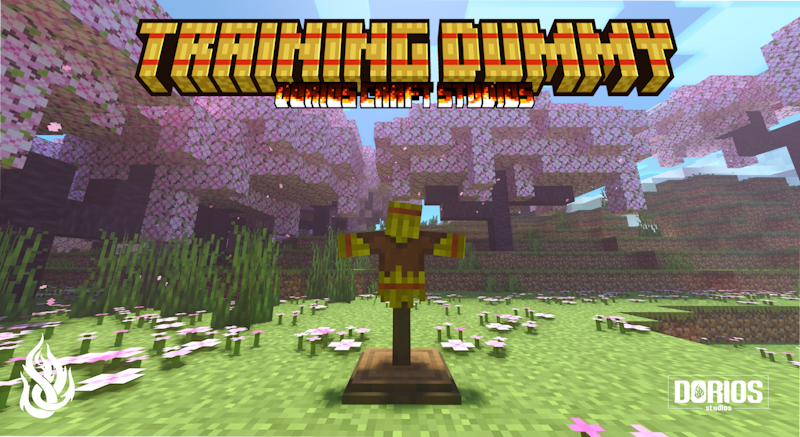

Use the **Training Dummy** to measure how hard a hit lands and how much damage your attack rhythm delivers. Placing the Dummy Block spawns a stationary target in front of you.

## Crafting and Placement

At a crafting table, put **1 hay bale** above the middle of a row of **3 logs**. Place the resulting **Dummy Block** where you can stand at your usual attack distance.

## Reading Damage

| Display | What it measures |
| --- | --- |
| Floating damage number | The damage Bedrock reported for one hit credited to a player. |
| DPS above the dummy | Total damage from player hits in the last 20 game ticks, about one second at normal tick speed. |

Both readings update automatically. Wait for the DPS display to return to zero before trying another weapon or loadout. If a projectile or scripted ability registers no reading, check whether Bedrock credits the hit to the player.
