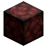
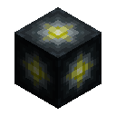
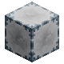

Compressy reúne materiales comunes en bloques o paquetes que puedes descomprimir después. Estas recetas corresponden a la versión **1.0.3**.

  
  
  

## Comprimir y descomprimir {#recipes}

Llena la cuadrícula 3×3 de la mesa de trabajo con una unidad del material en cada casilla para obtener un resultado comprimido. Pon un resultado comprimido en la cuadrícula para recuperar las nueve unidades. El **papel** es la excepción: coloca seis hojas en dos filas completas para fabricar una resma, que devuelve seis hojas.

## Niveles de compresión {#tiers}

Cada nivel usa nueve bloques del nivel anterior. La mayoría de los materiales llega al nivel 4. El adoquín llega al nivel 9. Las estrellas del Nether tienen un paso inicial: nueve estrellas forman un bloque de estrella del Nether, que tiene cuatro niveles de compresión. Su nivel 4 equivale a **59,049 estrellas**.

| Nivel | Unidades del bloque original |
| ---: | ---: |
| 1 | 9 |
| 2 | 81 |
| 3 | 729 |
| 4 | 6,561 |
| 5 | 59,049 |
| 6 | 531,441 |
| 7 | 4,782,969 |
| 8 | 43,046,721 |
| 9 | 387,420,489 |

## Materiales compatibles {#materials}

| Familia | Material de la receta |
| --- | --- |
| Roca | Adoquín, andesita, basalto, bloque de espeleotema, calcita, diorita, granito, netherrack, obsidiana, obsidiana llorosa, piedra, piedra del End, piedra negra, pizarra profunda, roca de pizarra profunda y toba |
| Suelos y construcción | Arcilla, arena, arena de almas, arena roja, bloque de miel, bloque de musgo, bloque de slime, grava, lodo, tierra, tierra de almas y vidrio |
| Bloques de almacenamiento | Amatista, carbón, cobre, cuarzo, diamante, esmeralda, hierro, lapislázuli, netherita, oro, redstone, cobre bruto, hierro bruto, oro bruto y estrella del Nether |
| Madera | Acacia, abedul, cerezo, jungla, mangle, roble, roble oscuro, roble pálido y abeto, además de bloque de bambú e hifas carmesí y distorsionadas |
| Tintes y cultivos | Los 16 tintes, granos de cacao, vaina de planta odre y semillas de calabaza, flor antorcha, remolacha, sandía y trigo |
| Otros objetos | Azúcar, galleta, hilo, lágrima de ghast, ojo de araña, ojo de araña fermentado, palo, papel, pluma, polvo de blaze, polvo de piedra luminosa, pólvora, saco de tinta, saco de tinta brillante, vara de blaze y vara de brisa |

Compressy comparte identificadores de bloques y objetos con UtilityCraft. Usa Compressy por separado en mundos donde solo quieras las recetas de compresión.

[Recetas de compresión y descompresión](https://github.com/DoriosStudios/Compressy/tree/970fce3bebe70d96d6cecade2e738c982bf6e90f/BP/recipes/compressed)
