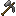
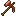
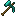
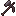

Un **Paxel** combina un pico, un hacha y una pala. Una **AIOT** añade las funciones de la espada y la azada, con una acción de cultivo en un área de 3×3. Esta guía usa las definiciones de la versión **1.0.5**.

## Recetas {#recipes}

| Herramienta | Ingredientes |
| --- | --- |
| Paxel | 1 pico, 1 pala y 1 hacha del mismo material, más 4 hilos y 2 palos |
| AIOT | 1 Paxel, 1 espada y 1 azada del mismo material, más 3 unidades de ese material, 2 hilos y 1 palo |
| Paxel o AIOT de netherita | En la mesa de herrería, usa la herramienta de diamante correspondiente, 1 plantilla de mejora de netherita y 1 lingote de netherita |

Usa tablas para una AIOT de madera, adoquín para piedra y lingotes para cobre, hierro y oro. Para diamante, usa tres diamantes.

### Cuadrícula de fabricación {#crafting-grid}

Lee las casillas de izquierda a derecha, de arriba abajo.

| Fila | Paxel | AIOT |
| --- | --- | --- |
| Superior | Hilo · Pala · Hilo | Material · Espada · Material |
| Central | Hacha · Palo · Pico | Hilo · Paxel · Azada |
| Inferior | Hilo · Palo · Hilo | Palo · Hilo · Material |

## Estadísticas por material {#tiers}

La velocidad de minado muestra el intervalo de las reglas configuradas para los bloques. El tiempo para romper un bloque también depende del bloque y de las condiciones. Ambas familias usan el tipo de encantamiento de hacha de Bedrock.

### Paxels {#paxels}

| Material | Durabilidad | Daño | Encantabilidad | Velocidad de minado |
| --- | ---: | ---: | ---: | ---: |
|  Madera | 180 | 3 | 16 | 10 |
|  Piedra | 249 | 4 | 6 | 12 |
|  Cobre | 573 | 4 | 14 | 13 |
|  Hierro | 753 | 5 | 15 | 14 |
|  Oro | 288 | 3 | 30 | 30 |
|  Diamante | 4,683 | 6 | 11 | 16 |
|  Netherita | 6,093 | 7 | 16 | 24 |

### AIOTs {#aiots}

| Material | Durabilidad | Daño | Encantabilidad | Velocidad de minado |
| --- | ---: | ---: | ---: | ---: |
|  Madera | 300 | 5 | 18 | 10–20 |
|  Piedra | 655 | 6 | 8 | 12–24 |
|  Cobre | 955 | 6 | 16 | 13–26 |
|  Hierro | 1,255 | 7 | 17 | 18–30 |
|  Oro | 480 | 5 | 40 | 30 |
|  Diamante | 7,805 | 8 | 13 | 20–30 |
|  Netherita | 12,155 | 9 | 18 | 24–30 |

## Usar una AIOT en un bloque {#actions}

- Úsala de pie para arar los suelos compatibles y cosechar los cultivos compatibles en un área de 3×3.
- Úsala agachado para crear caminos en los suelos compatibles en un área de 3×3.
- La herramienta también quita nieve y capas de nieve en el área de 3×3 a la altura del bloque seleccionado y un bloque por encima. Esta acción funciona de pie o agachado.

[Definiciones de las herramientas](https://github.com/DoriosStudios/Paxels-and-AIOTs/tree/bd78730d77f8aa99676b554166a4d452e938ee83/BP/items) · [Recetas](https://github.com/DoriosStudios/Paxels-and-AIOTs/tree/bd78730d77f8aa99676b554166a4d452e938ee83/BP/recipes) · [Acciones de área](https://github.com/DoriosStudios/Paxels-and-AIOTs/tree/bd78730d77f8aa99676b554166a4d452e938ee83/BP/scripts/items)
