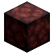
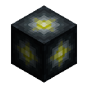
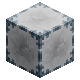

Compressy transforma pilhas de materiais comuns em blocos ou pacotes que você pode descompactar depois. Estas receitas correspondem à versão **1.0.3**.

  
  
  

## Compactar e descompactar {#recipes}

Preencha a grade 3×3 da bancada com uma unidade do material por espaço para obter um resultado compactado. Coloque um resultado compactado na grade para recuperar as nove unidades originais. O **papel** é a exceção: seis folhas em duas linhas completas formam uma resma, que devolve seis folhas.

## Níveis de compactação {#tiers}

Cada nível usa nove blocos do nível anterior. A maioria dos materiais chega ao nível 4. O pedregulho vai até o nível 9. Para estrelas do Nether há uma etapa inicial: nove estrelas formam um Bloco de Estrela do Nether, que pode ser compactado em quatro níveis. O nível 4 equivale a **59.049 estrelas**.

| Nível | Unidades do bloco original |
| ---: | ---: |
| 1 | 9 |
| 2 | 81 |
| 3 | 729 |
| 4 | 6.561 |
| 5 | 59.049 |
| 6 | 531.441 |
| 7 | 4.782.969 |
| 8 | 43.046.721 |
| 9 | 387.420.489 |

## Materiais aceitos {#materials}

| Família | Material da receita |
| --- | --- |
| Pedras | Andesito, basalto, calcita, diorito, granito, netherrack, obsidiana, obsidiana chorona, pedra, bloco de espeleotema, pedra do End, pedra-negra, pedregulho, pedregulho de ardósia, ardósia e tufo |
| Solo e construção | Argila, areia, areia das almas, areia vermelha, bloco de mel, bloco de limo, bloco de musgo, cascalho, lama, solo das almas, terra e vidro |
| Blocos de armazenamento | Ametista, carvão, cobre, diamante, esmeralda, ferro, lápis-lazúli, netherita, ouro, quartzo, redstone, cobre bruto, ferro bruto, ouro bruto e Estrela do Nether |
| Madeira | Acácia, bétula, carvalho, carvalho escuro, carvalho pálido, cerejeira, floresta, mangue e pinheiro, além de bloco de bambu e hifas carmesim e distorcidas |
| Corantes e cultivos | Todos os 16 corantes, grãos de cacau, vagem de planta-jarro e sementes de abóbora, beterraba, flor-tocha, melancia e trigo |
| Outros itens | Açúcar, biscoito, graveto, lágrima de ghast, linha, olho de aranha, olho de aranha fermentado, papel, pena, pólvora, pó de blaze, pó de pedra luminosa, bolsa de tinta, bolsa de tinta brilhante, vara de blaze e vara de breeze |

Compressy compartilha identificadores de itens e blocos com UtilityCraft. Use Compressy separadamente em mundos onde deseja apenas as receitas de compactação.

[Receitas de compactação e descompactação](https://github.com/DoriosStudios/Compressy/tree/970fce3bebe70d96d6cecade2e738c982bf6e90f/BP/recipes/compressed)
