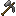
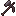

O **Paxel** combina picareta, machado e pá. A **AIOT** reúne essas ferramentas com espada e enxada e oferece uma ação de cultivo em área 3×3. Este guia usa as definições da versão **1.0.5**.

## Receitas {#recipes}

| Ferramenta | Ingredientes |
| --- | --- |
| Paxel | 1 picareta, 1 pá e 1 machado do mesmo material, mais 4 linhas e 2 gravetos |
| AIOT | 1 Paxel, 1 espada e 1 enxada do mesmo material, mais 3 unidades daquele material, 2 linhas e 1 graveto |
| Paxel ou AIOT de netherita | Na bancada de ferraria, use a ferramenta de diamante correspondente, 1 molde de melhoria de netherita e 1 barra de netherita |

Para uma AIOT de madeira, o material extra são tábuas. Para pedra, use pedregulho. Para cobre, ferro e ouro, use barras. Para diamante, use três diamantes.

### Grade de fabricação {#crafting-grid}

Leia os espaços da esquerda para a direita, de cima para baixo.

| Linha | Paxel | AIOT |
| --- | --- | --- |
| Superior | Linha · Pá · Linha | Material · Espada · Material |
| Central | Machado · Graveto · Picareta | Linha · Paxel · Enxada |
| Inferior | Linha · Graveto · Linha | Graveto · Linha · Material |

## Estatísticas por material {#tiers}

A velocidade de mineração mostra o intervalo das regras configuradas para os blocos. O tempo para quebrar um bloco também depende do bloco e das condições. As duas famílias usam o tipo de encantamento de machado do Bedrock.

### Paxels {#paxels}

| Material | Durabilidade | Dano | Encantabilidade | Velocidade de mineração |
| --- | ---: | ---: | ---: | ---: |
|  Madeira | 180 | 3 | 16 | 10 |
|  Pedra | 249 | 4 | 6 | 12 |
|  Cobre | 573 | 4 | 14 | 13 |
|  Ferro | 753 | 5 | 15 | 14 |
|  Ouro | 288 | 3 | 30 | 30 |
|  Diamante | 4.683 | 6 | 11 | 16 |
|  Netherita | 6.093 | 7 | 16 | 24 |

### AIOTs {#aiots}

| Material | Durabilidade | Dano | Encantabilidade | Velocidade de mineração |
| --- | ---: | ---: | ---: | ---: |
|  Madeira | 300 | 5 | 18 | 10–20 |
|  Pedra | 655 | 6 | 8 | 12–24 |
|  Cobre | 955 | 6 | 16 | 13–26 |
|  Ferro | 1.255 | 7 | 17 | 18–30 |
|  Ouro | 480 | 5 | 40 | 30 |
|  Diamante | 7.805 | 8 | 13 | 20–30 |
|  Netherita | 12.155 | 9 | 18 | 24–30 |

## Usar uma AIOT em um bloco {#actions}

- Use em pé para arar os solos aceitos e colher os cultivos compatíveis em uma área 3×3.
- Use agachado para criar caminhos de terra nos solos aceitos em uma área 3×3.
- A ferramenta também remove neve e camadas de neve na área 3×3, na altura do bloco alvo e um bloco acima. Essa ação funciona em pé ou agachado.

[Definições das ferramentas](https://github.com/DoriosStudios/Paxels-and-AIOTs/tree/bd78730d77f8aa99676b554166a4d452e938ee83/BP/items) · [Receitas](https://github.com/DoriosStudios/Paxels-and-AIOTs/tree/bd78730d77f8aa99676b554166a4d452e938ee83/BP/recipes) · [Ações em área](https://github.com/DoriosStudios/Paxels-and-AIOTs/tree/bd78730d77f8aa99676b554166a4d452e938ee83/BP/scripts/items)
